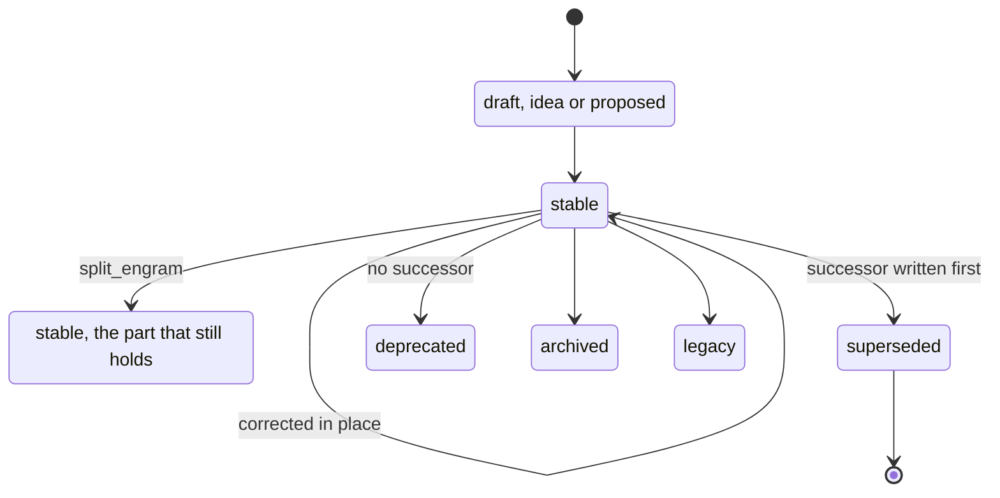

# Verify, evolve and doctor

Three checks ask three questions: does the format hold, is the machinery healthy and is the knowledge still true.

## Keep knowledge honest

`crystalline verify` statically checks one or more domains against the full rule catalog (malformed frontmatter, broken links, missing MANIFEST sections, schema drift) with no database, service or network connection involved. Its usual home is CI/CD on the GitHub repositories that hold a team's knowledge: every proposal is verified before the team merges it, so nothing malformed ever lands on the branch everyone pulls from. The bundled GitHub Action wires that up:

```yaml
- uses: jordiboehme/crystalline/action@v0.32.1
  with:
    paths: knowledge/       # space-separated domain roots, default '.'
    strict: 'false'         # promote Warning rules to Error
    team-repository: 'false' # also run the team repository rules (0.30.0 and newer)
    version: v0.32.1        # crystalline binary tag to download, or 'latest'
```

The action ref (`@v0.32.1`) pins the action's own code. `version` pins the crystalline binary it downloads, so pinning both gives a fully reproducible check. The binary is checksum-verified, then the action runs `crystalline verify`, annotates the run and, on a pull request, posts a single summary comment kept up to date in place.

In the repository of a team domain, set `team-repository: 'true'`. It runs `crystalline verify --team-repository`, which fails on a Reflection switched on without a home (`M011`) and on files under `reflections/` while Reflection is on (`M012`), and warns when the MANIFEST lacks `team: github` (`M109`). See [Keep a team repository's Reflection safe](teams.md#keep-a-team-repositorys-reflection-safe).

A domain can tune the rules in a `.crystalline.yaml` at its root: under `verify.rules`, each rule id takes `off`, `error`, `warning` or `info` (for example `Q002: off`). Verify never fails on a mistake in that file, but it no longer keeps quiet about one either: a value that is not one of those words, or a file that does not parse, is reported as `M108`, a warning against `.crystalline.yaml` that names the rule and the word. The rule it was meant for runs at its default. `--strict` turns `M108` into an error like any other warning, which is how a CI run catches an override that was silently lost.

Verify is one of three checks, and each asks a different question. `crystalline verify` asks whether the format holds. `crystalline doctor` asks whether the machinery around it (the index, the registered domains, the service) is healthy. `crystalline evolve` asks the question neither of the other two can: is the knowledge itself still true, and is it still well organized? A fourth command, the importer, brings an existing knowledge base under Crystalline in the first place:

- **`crystalline evolve`** sweeps one domain or every domain for the maintenance the knowledge needs and prints a ranked queue, each finding naming the engram, the evidence it fired on and the exact next action. The queue prints with an `Actions:` legend, one line per rule with the fix spelled out, a `Truncated:` note where a rule capped its output and `nothing to work in this scope` on a clean domain. It sees temporal and lifecycle debt (a `valid_to` that elapsed while the status still reads current, a `stale_after` past due, long-unverified knowledge, a retirement whose replacement landed but whose old engram was never flipped, substantive work that has sat unshared in a team domain for a week), structural gaps (unresolved `[[links]]`, one-sided relation pairs, orphans, oversized engrams and stubs), the still-valid observations a retirement is about to take down with it, redundancy (near-duplicate clusters and drifted tags), and meaning (semantic twins - the same knowledge in different words - and, with the contradiction check on, a possible contradiction between two observation lines). Narrow it with `--domain`, `--family`, `--rule` or `--min-priority`, and pass `--today` to evaluate the temporal rules as of a fixed date so a run reproduces. It is read-only and detects by dates, links, graph shape, embedding similarity and stored model scores, never confirming a contradiction, so it hands over work to do rather than rewriting knowledge on its own. It is the same sweep the `evolve_engrams` tool gives an agent. Run it after a big ingest, when two search hits disagree and a half-finished retirement is the likely reason, or on the first session of a month; it is deliberate maintenance you ask for, never a session-start ritual. `crystalline evolve run` works the mechanical findings with a headless agent and shares the fixes as a pull request; see [Run the loops on their own](automation.md). On a team domain only one instance runs it on a schedule, the domain's evolve home (`evolve_home` in the MANIFEST, filled in by the first scheduled run at an instance with `service.public_url`); see [One evolve runner per team domain](teams.md#one-evolve-runner-per-team-domain).
- **`crystalline doctor`** diagnoses the index, registered domains and service state (orphan index rows, encoding issues, a frontmatter key that appears twice, stale service locks) and repairs what it safely can with `--fix` (a repeated key only when every copy has the same value). Once team domains are turned on it also reports whether this machine is connected to GitHub and whether each team domain's local origin state is intact, and, with a GitHub App, whether GitHub accepts its signed token, its installations can be listed, this machine's clock is within a minute of GitHub's and a webhook secret is set when `service.public_url` is. When a domain ships provisioned artifacts, it reports every declaring domain's decision and shipped counts and every installed harness's drift, locally edited and orphaned counts against what was last reconciled. That part, like the GitHub checks, is always report-only: `--fix` never reconciles a harness.
- **`crystalline import <src> --domain <name>`** brings an existing markdown-plus-frontmatter knowledge base under Crystalline: normalizes legacy `type` values, backfills `status` and temporal metadata, drops sentinel far-future dates in favor of leaving the field open-ended, and records write provenance where a file carries none. A file without `status` gets `stable` (OKF reads an absent status as stable; `--status legacy` keeps the rule before 0.29.0), a missing permalink is written as sync would derive it, and a file without tags gets the one tag `imported`. Tags a file has are never changed. The pictures and documents a note links to by a relative path are taken into `assets/<note path without .md>/` with clean names, stored once when several notes link the same bytes, and the links are rewritten to them. The report counts the files taken and the files no note links (those are still copied as they are), and lists every link it did not take with its reason: `missing`, `outside` the source folder, `not allowed` (a file type attachments do not take), `too large` (over 10 MiB) or `bad name`. Links between notes and links inside code stay as they are. It is all a file transformation, with `--dry-run` to preview first.

### Possible contradictions (V302)

With `evolve.contradictions` set to a profile, the daemon reads the observation lines of related engrams with a local natural-language-inference model after each embedding pass and stores what it reads. `evolve` then raises `V302` for two lines the model reads as contradicting each other, naming both lines with their engrams, the model's probability and how similar the two lines are. It is a judgment finding and a question, never a verdict: the model can be wrong, and it cannot see dates, so two true lines from different periods can read as a contradiction. Read both engrams. Supersede the one that is false going forward. When both held at different times, the newer engram supersedes the older one, whose `valid_to` is set to the real date (closing the window alone leaves it reading as current, which `V001` reports). When only one line is stale and the rest of its engram still holds, correct the line. Or acknowledge the pair with `evolve_ack` (`V302 <note>`); the acknowledgment holds for exactly those two lines, and a new disagreement between the same engrams still surfaces. After a supersede, `V010` may name the observation the retirement dropped; acknowledge it there when the drop is intended.

What it reads: two current engrams in one domain (neither speculative and not past its `valid_to`, validity windows overlapping) whose lead embeddings are related. Every observation line of one is compared with every line of the other by the cosine of their line embeddings. Only line pairs about the same subject reach the model: every line pair at or above the embedding model's line-similarity floor (0.86 for granite-embedding-97m-multilingual-r2). A safety cap of 32 line pairs per pair of engrams bounds the worst case: when more stand above the floor, the 32 most similar are read, and the daemon log says once per walk how many pairs of engrams the cap bound on. A line pair is a finding when the contradiction probability is 0.95 or more in both reading orders. An embedding model without a measured floor runs no `V302`, and the sweep says so in one line. There is one finding per pair of engrams: its strongest line pair with both lines, the probability and the line similarity, and "and N more line pairs" when more stand. At most ten of them are kept per domain, the highest probability first among findings of the same priority. Acknowledging a line pair hands the pair of engrams to its next line pair. A line that names a period (a year, a date, a month, since or until) adds a sentence pointing at the supersede with the real end date. Only the daemon scores and counts. `evolve` reads what the daemon stored, and a truncation line says how many related pairs are not scored yet, or that they are not counted yet when the domain changed since the daemon's last pass or no daemon has looked at it. When the model could not be loaded, the line says so instead and points at `crystalline status` and `crystalline doctor`; setting `evolve.contradictions` again or restarting the daemon retries the load. A read-only daemon refuses the setting, so there only a restart does. A download that failed, or that sent no data for two minutes, is tried again by the daemon on its own, the wait doubling from five minutes up to an hour. The two-minute stall guard covers the time until data starts to flow; once the model weights are transferring, a connection that stops sending is bounded only by the download library's own timeouts, about 300 seconds each, and any retries it makes after one.

| `evolve.contradictions` | Model | For |
|---|---|---|
| `off` (default) | none | no scoring, no download |
| `full` | mDeBERTa-v3-base-xnli-multilingual-nli-2mil7 | German, English and mixed; a 558 MB download, about 550 MB on disk; a loaded model adds about 2.6 GB of memory on the CPU and about 1.8 GB on Apple Silicon (up to about 3.2 GB while scoring there), and is unloaded after 10 to 15 idle minutes |

`full` needs a build with the `local-embeddings` feature (every published binary and image has it) and downloads its model on first use into the same cache as the embedding model. A config file that still names a value this version does not know (`light` or `english-only` from a development build, or a typo) does not break anything: the check stays off, `crystalline status` and `crystalline doctor` say the value is not known and name the accepted ones, and `crystalline config set evolve.contradictions` refuses it the same way. `crystalline status` and `crystalline doctor` show the profile, the model, how many pairs are pending and how many observation lines are embedded, or why V302 does not run when the embedding model has no measured line-similarity floor. Drafts are never scored, so in a review-mode domain an author's open draft hides the V302 findings on the engram being drafted until it is published: the sweep reads the draft, and the stored rows belong to the published engram, the same way V301 speaks only about the version the caller reads. The model's weights are MIT licensed; the XNLI and ANLI data they were trained on is licensed for non-commercial use only.

### An engram's lifecycle

The states a `status` names and the moves between them:



The values are guidance, not an enum: `stable` is the default and the word for knowledge that holds now (`current` is its older spelling). A fact that stopped holding is superseded, never overwritten: write the successor first, then flip the old engram to `superseded` with a `superseded_by` relation and close its window with the real `valid_to`, or leave the window open when the date is unknown. Not every retirement has a successor. When a practice is simply abandoned, flip the status, close the window when the date is known and carry any lesson worth keeping into a live engram; the retirement is the whole edit. Each retirement word means one thing: `deprecated` says do not do this again, `superseded` says a newer engram replaced this one, `archived` says retired but kept for the record and `legacy` says still deployed and true of old installations but not to be built on. `delete` is for mistakes, not history. The sweep flags the half-done moves: a successor that landed while the old engram still reads `stable`, a `valid_to` that elapsed under a live status, and a split that left a fact behind that should have moved.

Evolve keeps the engrams honest. A domain with a Reflection has a second lifecycle beside it: `reflect` brings what the engrams learned into the domain's documents for people, and takes in what people changed there. See [The Reflection](reflection.md).

### Browse a domain without Crystalline

Every folder of a file domain carries a generated `index.md`: a plain markdown listing of the engrams in that folder (title plus description, linked relatively) and of the subfolders below it. Files under the domain's `assets/` folder are attachments, not engrams, so they are not listed, a markdown file there included. It is written after every write, edit, move, delete and sync, so a domain browsed in an editor, on a git forge or by any other tool navigates itself, with nothing running. The listing at the domain root additionally declares the knowledge format version with `okf_version: "0.2"`.

`index.md` and `log.md` are reserved filenames: Crystalline never indexes them, never searches them, never verifies them and refuses to file an engram under either name. The log is reserved only, never generated. Turn the generated listings off with `crystalline config set index.files false`. Existing files stay where they are and stay out of the index.
