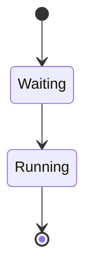

Text above the flowchart.
```mermaid
flowchart TD
  %% keep this comment
  A[Start]   -->   B[Middle] --> C[End]
  C -->|done|   D[Other]
  D    --> E[Last]
```

Text between the fences.



> A quoted flowchart.
>
> ```mermaid
> flowchart LR
>   Q[Quoted] --> R[Reply]
> ```

Text at the end.
