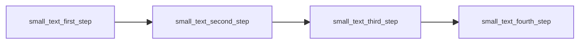
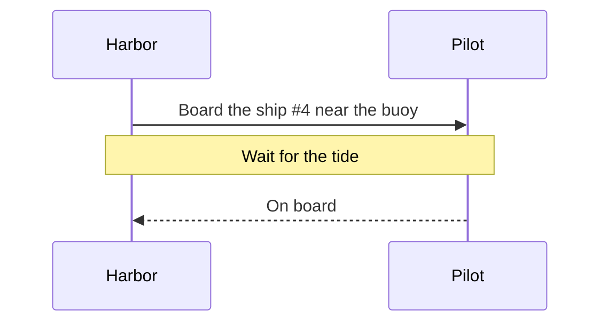
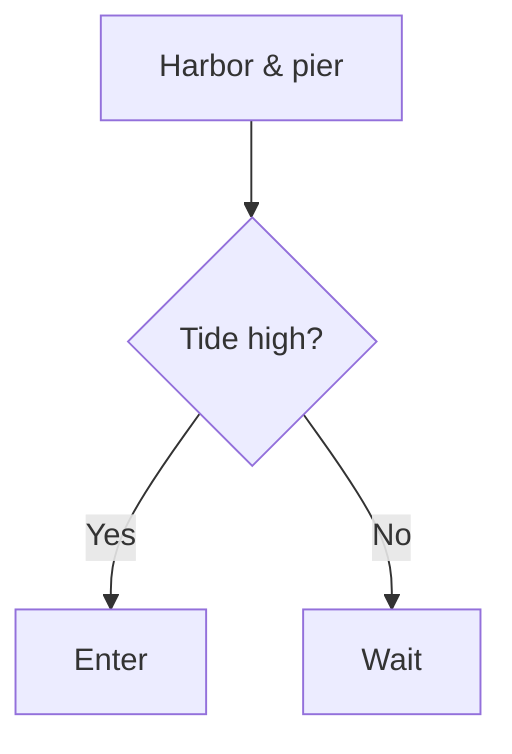
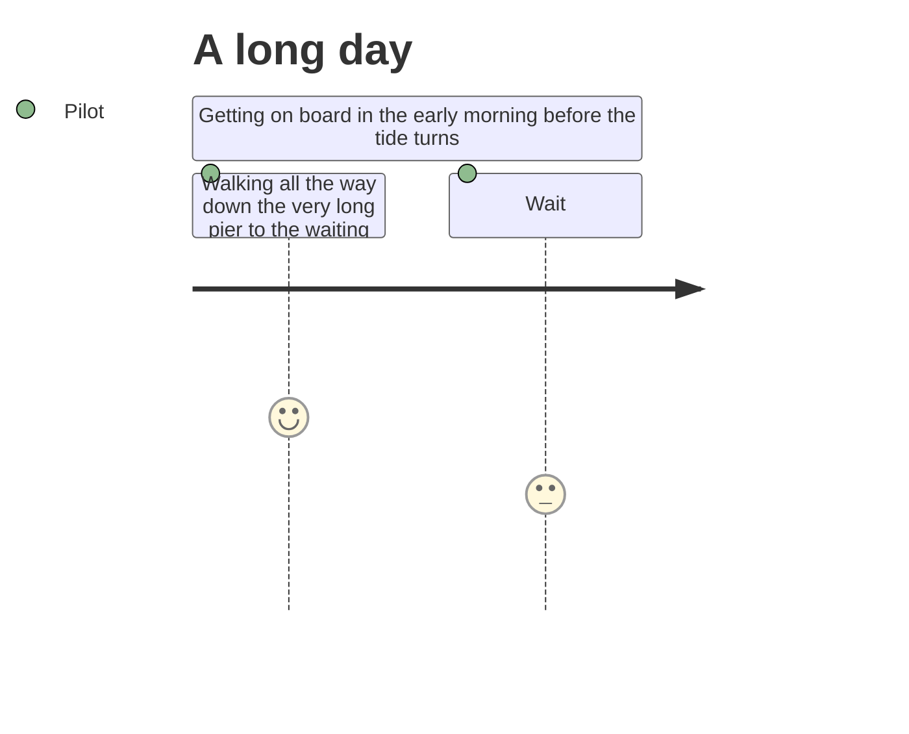

# Diagram Picture Files

A very wide flowchart, which the page shrinks to fit its column.


The same kind of drawing with small text.



A sequence diagram.



A short flowchart.



A drawing with a picture from another place.

```mermaid
flowchart TD
    P@{ img: "https://pictures.example.invalid/ship.png", label: "A ship", pos: "t", w: 60, h: 60 }
```

A user journey with long words, whose labels the page wraps in their boxes.



A flowchart with thin lines.


