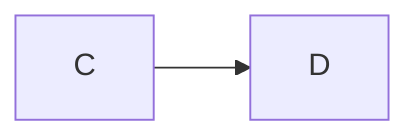

# Everything the editor draws

One file with every construct the hidden marks touch, for the fidelity
properties in `marks/fidelity.test.ts`.

## Emphasis

Plain **bold**, *italic*, _underscore italic_, ~~strike~~ and `code`.
Nested: **bold with *italic* inside** and *italic with **bold** inside*.
Both at once: ***both***, ___both___, **_mixed_** and *__mixed__*.
Adjacent: **a**_b_, *a**b**c*, `x`**y** and ~~s~~*t*.
Two words: **one** **two** and *one* *two*.
Spaced: **A bold** word and **Lead-in.** text after it.
Trailing: **bold b** word, where Backspace on `b` moves the closer.
A loose star: q * a* r stays text.

Wrapped: **a lead-in that wraps
here.** text, then **one
more** **two** words and **A spread
bold** end.

A loose star that wraps: q * a r
b* c stays text.

Escaped: \*not italic\*, \*\*not bold\*\*, \_no\_, \~\~no\~\~ and \`no\`.
Mixed escapes: **bold \* star** and *it \_ under*.
A backslash at the end of a code span: `a\` and a double `` a`b `` span.
Entities: &amp; &copy; &#169; &#x27; and &nbsp;between.

### Heading with **bold** and `code`

#### Heading with a [link](https://example.com)

## Links

An inline [link](https://example.com) and one [with a title](https://example.com "The title").
Angle brackets: [spaced](<docs/a file.md>) and [titled](<b c.md> 'single').
A [link with **bold** words](https://example.com/b) and an [empty title]().
An autolink <https://example.com> and a bare https://example.com/bare one.
A reference [link][ref], a collapsed [ref][] and a shortcut [ref].
A missing [reference][nowhere] stays text.
An image  next to [words](u).

[ref]: https://example.com/ref "Reference title"
[other]: <https://example.com/o p>

## Wikilinks

See [[tide-tables]], [[harbor/berths|the berths]] and [[Quay cranes#Weekly]].

## Footnotes

A sentence with a footnote[^one] and another[^long].
A footnote reference in a [link with a note[^one]](https://example.com).

[^one]: The first note.

[^long]: A note with two paragraphs.

    Its second paragraph is indented.

- A list item with a note[^item].

  [^item]: The note inside the list.

## Status labels

Plain :status[Done]{green}, no colour :status[Draft] and
escaped :status[a \] b]{red}, backslash :status[c \\ d]{blue}.

## Math

Inline $`x^2`$ and padded $` y + 1 `$ and long $``a`b``$ runs.
Dollars $$z = 1$$ and padded $$ w $$ on one line.

$$
E = mc^2
$$

```math
\int_0^1 x\,dx
```

- In a list:

  $$
  a + b
  $$

## Callouts

> [!NOTE]
> A note callout.

> [!WARNING]- Folded closed
> The body stays.

> [!TIP]+ Folded open
> With **bold** inside.

> A plain quote with *italic*.
>
> > A nested quote.

## Code

```ts title=x
const a = "**not bold**";
```

~~~mermaid
graph TD
  A --> B
~~~

~~~python
print("*not italic*")
~~~

    indented code with **stars**

```
no language
```

 ```sh
 echo "indented one space"
 ```



- A fence in a list:

  ```js
  let x = 1;
  ```

## Lists and tasks

- A bullet with **bold**
* A star bullet with *italic*
+ A plus bullet
  - A nested bullet with `code`

1. First
2. Second with [a link](u)
10) Tenth

- [ ] An open task
- [x] A done task with ~~strike~~
- [~] A task that does not apply
  - [ ] A nested open task

## Observations and relations

- [decision] We chose the tide model #arch #speed
- [fact] The quay opens at six and closes at ten, and the cranes are
  checked every week #harbor #cranes
- relates_to [[tide-tables]]
- part_of [[Harbor]] (the main one)

## Tables

| Kind | Sample |
| --- | --- |
| pipe | a \| b |
| backslash | c \\ d |
| bold | **strong** cell |
| link | [here](https://example.com) |
| wikilink | [[tide-tables]] |
| label | :status[Done]{green} |
| math | $`x`$ |

Kind | Sample
--- | ---
bare | *edge* cell

## Comments and ids

<!-- r:7f3a9c2e -->

A paragraph after an id line.

<!-- an HTML comment the page does not show -->

Text with an inline <!-- comment --> in it.

---

Setext heading
==============

Second setext
-------------

A line with a hard break  
and the next line.
