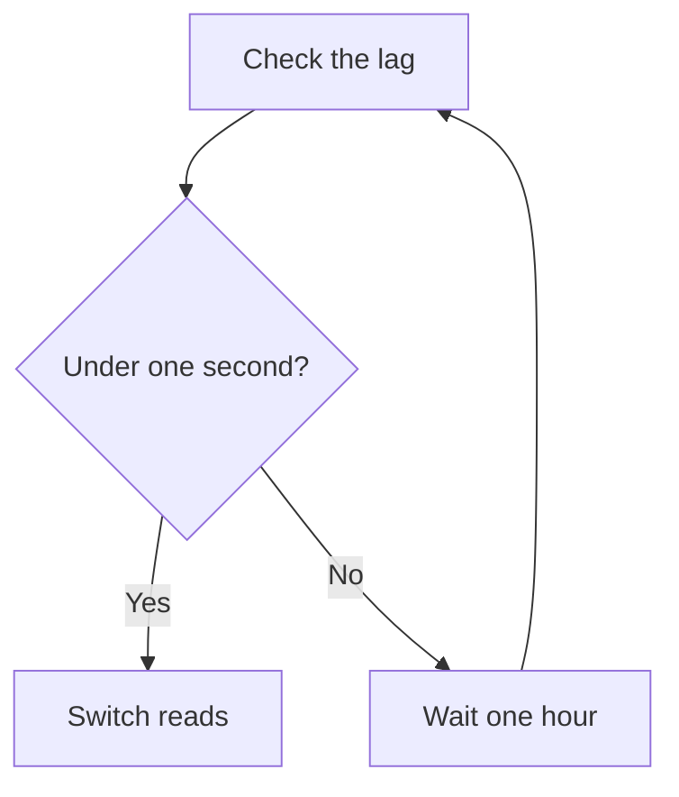

# Crystalline Presentation

A Reflection page is read by people. They come to it to understand a topic, to see where something stands and to know what to do next. Write it the way a good technical writer would: plain sentences, and the shape of the content shown in a table, a diagram, a status chip or a callout.

Engrams are different. They are your own knowledge as an agent, and you write them in whatever form serves the model best. The page elements below are for Reflection pages. The Engrams section further down says how to write them.

## When it applies

- You write or change a Reflection page, or `PACT.md`.
- You work a `reflect` queue: feedback items, update items and review items, also in a reflect run with nobody there.
- You answer a thread on a page.

## The PACT first

Before you write a page, read the domain's `PACT.md` with `read_reflection`. Its `## Presentation` section says which diagrams, callouts and tables help these readers and what to avoid. It narrows or extends the defaults in this skill, and where the two differ, the PACT wins. A PACT that says "no diagrams" means no diagrams, even where this skill requires one. A PACT that asks for plain text and tables only means no callouts and no diagrams, not even a caution before an irreversible step: say the warning in a sentence.

When the PACT has no `## Presentation` section, use the defaults below. If you see a pattern the readers would want written down, propose it: write it into `PACT.md` when you may curate and a person is in the session, otherwise open a thread with `discuss`.

When you rewrite a whole page, pass the `checksum` from `read_reflection` as `expected_checksum`, so a change a person made since your read is refused instead of overwritten.

Record the engrams each section was built from with `sources` on `write_reflection`, as permalinks in this domain or `crystalline://<domain>/<permalink>` addresses for another domain; never write them into the page as HTML comments or text. Cite another domain only when everyone who reads this page may read that domain too: a source in a domain fewer people may read is refused, and a `source_too_wide` item in `reflect` asks you to remove such a source and the text drawn from it. Either way leave out the sentences drawn from that source too: the check sees only the sources you name.

A person who may read that domain may still share such text on purpose. So when a write is refused for this reason, do not drop the source and keep its text: tell your person which domain the text comes from and who reads the page, and ask them. When their client can put a question to them, the same `write_reflection` asks them first and lands only on their yes; when it cannot, the refusal says so, and they decide to leave the text out or write it on a page in that domain. A person can also share a section a `source_too_wide` item names, in Fluid's Review. The question is a deliberate step for your person, not a guard against you: never answer it yourself and never ask them to agree without showing them the text. One yes covers that person's later edits of the page that draw on the same domain; another person, or another domain, is asked again. In an unattended run nobody can agree, and the run cannot read such a domain at all: leave the source and its text out.

## Readers and language

Many readers do not speak English as their first language. Some readers cannot see engrams. Write so that every reader understands the page on the first read.

- **Explain every term, acronym and coined name the first time it appears.** Before: "Check the lag first." After: "First check the lag: how far the new database is behind the old one."
- **Use no reference the reader cannot follow.** No engram permalinks or engram links, no names of internal plans, no short lists of IDs. Before: "As in ADR-2/19 and the Falcon plan." After: "As decided before: one service owns all writes."
- **Lead with why, or with what the reader can see.** Before: "Changed the sort keys to byte order." After: "The two backends sorted one list differently. Now they agree."
- **Write short sentences, one idea each.** Before: "The job, which runs at night and also on demand, retries, unless the store is down, three times." After: "The job runs at night and on demand. It retries three times. It does not retry when the store is down."
- **Use plain words.** Before: "We utilize the gateway, which serves as the entry point." After: "We use the gateway. It is the entry point."
- **Use verbs, not nouns made from verbs.** Before: "The implementation of caching is done by the gateway." After: "The gateway caches responses."
- **Make definite claims.** Mark knowledge that is not settled with a status chip, not with soft words. Before: "It may perhaps be advisable to retry." After: ":status[Proposed]{purple} Retry twice, then fail."
- **Avoid the words readers link with machine-written text:** delve, robust, crucial, pivotal, leverage, landscape, showcase, "it's important to note", "worth noting", "let's dive in". Before: "Let's delve into this robust design." After: "The design has three parts."
- **Use no em dash and no en dash.** Use a full stop or a colon. A hyphen belongs only in compound words such as "read-only". Before: "The store is the record, nothing else is" written with a long dash. After: "The store is the record. Nothing else is."
- **End on the last fact.** No closing summary and no closing wish. Before: "In summary, the export is faster. I hope this helps." After: "Exports now finish in 8 seconds."

Shape the page around the questions the reader brings, not around the order you learned things in. Start with a lead paragraph above the first `##`: what the page is for and who it is for. Use the PACT's terms, and use each term the same way everywhere.

## Show the shape

On a Reflection page: when the content has a shape, show it. A status is a chip, a list of attributes is a table, an order of messages is a diagram. A reader sees the shape faster than they read it in a paragraph. Prose carries what has no shape: the reason, the context, the one sentence that leads into a table or a diagram.

### Where an element is required

These shapes need their element. A numbered list or a paragraph is not enough for them.

- **Messages or steps between two or more parties in a fixed order** (a client, a server, a third service): a `sequenceDiagram`. Always, even for three steps.
- **A process with a decision or a branch** ("if the check fails, ..."): a `flowchart`.
- **States and the moves between them** (draft, active, closed): a `stateDiagram-v2`.
- **Three or more options compared on the same attributes**: a table, one row per option. Not a bullet list, and not one `##` section per option. When the source gives a verdict, add a verdict column with status chips.
- **An action that cannot be undone, or a risky one**: a `> [!WARNING]` or `> [!CAUTION]` callout inside the section that describes that action, directly before or after the step. Never in the page lead (the text above the first `##`), and never folded.

### More shapes

| The content is | Show it as |
| --- | --- |
| Anything with a status: a step, an option, a decision, a risk | a status chip in the colour from Status colours below |
| A list of attributes (name, owner, port, limit) | a table, not a long bullet list |
| Dates and phases | a `timeline` or a `gantt` chart |
| Numbers over time | an `xychart-beta` |
| Shares of a whole | a `pie` |
| Priorities, effort against value | a `quadrantChart` |
| A map of a topic and its parts | a `mindmap` |
| A data model, entities and how they relate | an `erDiagram` |
| The key point the page leads with | a `> [!IMPORTANT]` or `> [!NOTE]` box in the lead |
| A prerequisite the reader must not miss | a `> [!IMPORTANT]` callout |
| A shortcut or a better way | a `> [!TIP]` callout |
| Long reference detail or optional steps | a folded `> [!DETAILS]-` callout |
| A formula | math |
| Things people act on and tick off | a task list |
| Caveats and citations | footnotes |

### Content, never decoration

Every element carries content. A table with no rows, a diagram with one box or a callout that repeats the sentence before it is decoration: leave it out. A one-line how-to stays one line.

- Put a sentence before each diagram that says what it shows. One diagram per idea, about a dozen nodes at most.
- Use the reader's words for labels, in diagrams, tables and chips.
- Never two callouts in a row, and never a callout inside a callout.
- Never fold a warning or a caution: a risk the reader has to open is a risk the reader misses.
- Do not set colours or a theme inside a mermaid diagram. The page sets them for light, dark and print.
- A status chip always carries a word ("Blocked", "Done"), not only a colour.

## Status colours

Every page uses the same six colours for the same meaning:

- **green**: done, decided, stable, recommended
- **blue**: in progress, in review
- **yellow**: at risk, partial, needs attention
- **red**: blocked, failed, not recommended, deprecated
- **purple**: proposed, idea, draft
- **grey**: not started, unknown, retired

Write a chip as `:status[In progress]{blue}`. Put it in the table cell or the sentence it belongs to.

A section built from an engram that is not settled yet shows that with a chip. Map the engram's `status` like this:

| Engram status | Chip |
| --- | --- |
| draft, proposed, idea, poc, open | purple, for example `:status[Proposed]{purple}` or `:status[Idea]{purple}` |
| deprecated | red, for example `:status[Deprecated]{red}` |
| archived, superseded, legacy | grey, for example `:status[Retired]{grey}` |
| active, stable, decided | no chip needed, unless the content has a status of its own |

Put the chip at the start of the section's first paragraph, or in the row the engram fills. Then write the text as a definite claim.

## Check before you write each section

1. Do two or more parties send each other something in order? Draw a `sequenceDiagram`.
2. Does the process branch on a decision? Draw a `flowchart`.
3. Does something move between named states? Draw a `stateDiagram-v2`.
4. Do I compare three or more options, or list attributes? Write a table.
5. Does something here have a status, or come from an engram that is not settled? Add a status chip in the scheme colour.
6. Are there dates, numbers over time, shares or priorities? Use the chart from the More shapes table.
7. Does this section describe a step that cannot be undone? Put the callout here, at that step.
8. What is left is prose: short sentences that say why and lead into the elements.

## Example

Four engrams. `orders-db-move` (status active) holds the steps of a database move, who owns each and how far each is. `orders-db-switch` (status active) says reads move to the new database once its lag is under one second, and otherwise wait an hour and check again. `orders-db-shutdown` (status active) says the shutdown deletes the old database and cannot be undone. `orders-db-copy` (status idea) says a read-only copy of the old database could stay for one year.

The page they become:

````markdown
# Moving the orders database

The orders database moves to a new cluster this quarter. This page is for the on-call team. It shows where the move stands and what each step needs.

> [!IMPORTANT] Reports still read from the old database
> Until the switch, every report reads from the old cluster.

## Where the move stands

| Step | Owner | Status |
| --- | --- | --- |
| Copy the data | Data team | :status[Done]{green} |
| Write to both databases | Orders team | :status[In progress]{blue} |
| Switch reads | Orders team | :status[Not started]{grey} |
| Shut down the old database | Platform team | :status[Not started]{grey} |

## How reads switch

Reads switch when the new database has caught up. The lag is how far the new database is behind the old one:



## Shutting down the old database

Shut it down one week after the switch.

> [!CAUTION] The shutdown deletes the old database
> It cannot be undone. Take a last backup first.

Then start the shutdown from the cluster console.

## A copy of the old database

:status[Idea]{purple} A read-only copy of the old database stays for one year, for audits.
````

## Pictures

To put an image into a reflection, upload it with `write_reflection` action `write_asset` (a `path` under `assets/` plus `content` for SVG text or `base64` for a binary picture), then embed it as `` relative to the page's folder.

## Feedback

When a comment says "how does X work?" or "I don't follow", more words are not always the answer. A flow that is hard to follow in prose is often easy to follow in a `flowchart` or a `sequenceDiagram`, and a comparison in a table. Then answer the thread in plain words and say what you changed.

## Engrams

Engrams are your knowledge as an agent. You write and manage them in whatever form serves the model best: to store, to find and to use the knowledge later. People do not need to read them, so the stance above does not apply to them. Use a table or a diagram in an engram only when it makes the knowledge easier to find or to use.

One rule holds for every engram: observations and relations stay top-level bullets, never inside a callout. An observation or relation inside a callout is not indexed (lint Q008), and the same holds inside any `>` quote. Task items (`- [ ]`, `- [x]`, `- [~]`) are never observations, so do not use them to record facts.

## Syntax sheet

Every element reads sensibly as raw Markdown, and on GitHub too: a callout with a title or a fold sign falls back to a plain quote, and a status chip reads as text. The full reference is at https://github.com/jordiboehme/crystalline/blob/main/docs/markdown.md.

| Element | Raw form | Notes |
| --- | --- | --- |
| Callout | `> [!NOTE]`, `> [!TIP]`, `> [!IMPORTANT]`, `> [!WARNING]`, `> [!CAUTION]`, `> [!DETAILS]` | The marker is the first line of a blockquote; the body is the rest of the quote. The kind is case-insensitive. An unknown kind stays a plain quote (lint Q007). |
| Callout title | `> [!WARNING] Data loss` | Optional, on the same line. Without it the title is the kind's word. |
| Folding | `> [!DETAILS]- Rollback steps`, `> [!NOTE]+ Background` | The sign comes right after `]`: `-` folds closed, `+` folds open. `> [!DETAILS]` without a sign folds closed; other kinds without a sign do not fold. |
| Status chip | `:status[In review]{blue}` | Inline, in prose and in table cells. The colour is exactly one of grey, blue, green, yellow, red, purple (case-insensitive). Without `{...}` it is grey; any other colour renders grey (lint Q006). An empty label stays text. |
| Inline math | `` $`a^2 + b^2`$ `` or `$$a^2 + b^2$$` on one line | A single `$` is always a plain dollar sign. |
| Block math | `$$` on its own line before and after, or a ```` ```math ```` fence | One formula per block. |
| Task list | `- [ ]` open, `- [x]` done, `- [~]` not applicable | People tick them on the page. A tick alone is not a feedback item in the reflect queue. |
| Footnote | `text[^1]` and `[^1]: the note` | On a reflection page the reference and its definition must be in the same section (the same `##` section), because each section renders on its own. |
| Colour swatch | `` `#0969DA` ``, `` `rgb(9, 105, 218)` ``, `` `hsl(212, 92%, 45%)` `` | Only inline code that holds one colour code and nothing else gets a swatch. |
| Diagram | a ```` ```mermaid ```` fence | See the diagram types below. |

`:status[...]` is the only directive. Any other `:word`, `::word` or `:::word` is ordinary text, so `10:30` or `note:this` is safe to write.

Diagram types that render in light, dark and print: `flowchart`, `sequenceDiagram`, `stateDiagram-v2`, `classDiagram`, `erDiagram`, `gantt`, `pie`, `timeline`, `journey`, `quadrantChart`, `mindmap`, `C4Context`, `requirementDiagram`, `architecture-beta`, `xychart-beta`, `radar-beta` and `gitGraph`.

Mermaid pitfalls:

- The first line names the diagram type. Use one of the types above.
- Quote a label that holds special characters such as `(`, `)`, `:`, `#` or `;`: `A["Retry (3x)"]`.
- Keep node counts small, about a dozen at most. Split a big diagram into two ideas.
- Do not set colours or a theme in the diagram. The page sets them for light, dark and print.

## Fix what the receipt reports

The receipts of `write_engram`, `edit_engram` and `write_reflection` carry `markdown_findings` when the text has a problem: a list of `{code, severity, message, line}`. Q006 is an unknown status colour, Q007 an unknown callout kind, and Q008 (engrams only) an observation or relation inside a callout. Fix each finding at its line and write again, so the page renders the way you meant it.
